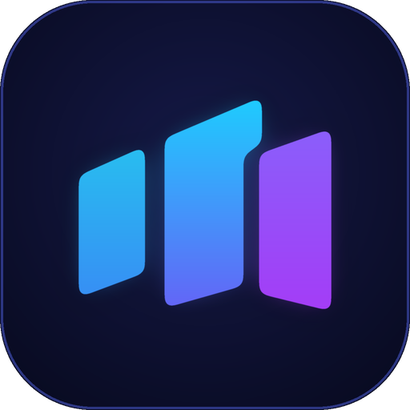

<p align="center"></p>

# Swivora

**Your Workspace, One Switch.**

[](https://ko-fi.com/rifqyattaufi) [](https://saweria.co/rifqyattaufi)

Pick a mode when you sign in to Windows, then switch modes and project workspaces on the fly.

You can have as many **modes** as you like, of two kinds:

- **Apps mode** (like *Gaming*): one list of apps, started together (Discord, Steam, ...).
- **Workspaces mode** (like *Work*): one **workspace per project**. Each workspace has its own app list (for example only one of them needs Docker) and opens on its **own Windows virtual desktop**.

Several workspaces of a mode can run at once. Switching between them only changes the desktop, so nothing is closed or restarted. Switching **mode** closes the old mode's apps politely (like clicking X) and starts the new ones. Apps that both modes use stay open.
- Everything is driven from a tray icon, a picker window and global hotkeys. A settings window edits the config.

## Requirements

- Windows 11 24H2, build 26100.2605 or newer, for separate virtual desktops.
- On other Windows builds the app still runs, but workspaces share your current desktop and a notice says so.

## Install

Build a self-contained release (no .NET needed on the target PC):

```powershell
.\scripts\publish.ps1
```

Run `publish\Swivora.exe`. Keep `VirtualDesktopAccessor.dll` next to it. Turn on **Settings > General > Start when I sign in** to get the picker at every sign-in.

To build from source you need the .NET 10 SDK. `dotnet test` runs the tests; they open and close a few real windows (winver, charmap) and briefly flip a virtual desktop.

## Use

| Action | How |
|---|---|
| Open the picker | Tray icon click, `Ctrl+Alt+P`, or start the exe again |
| Start a mode | Picker or tray menu. `Ctrl+Alt+M` cycles to the next mode |
| Jump to workspace N | `Ctrl+Alt+1` ... `Ctrl+Alt+9` (opens it if it is not running; counted across all workspaces modes) |
| Jump to mode N | Off by default. Set `Open mode N` in Settings > Hotkeys |
| New mode | Settings > Apps > Add mode, or tray > Add mode |
| New workspace | Picker > a workspaces mode > Add workspace, then fill in its apps |
| Close one workspace | Tray > Close workspace |
| Add an app | Settings > Apps > Add app. Pick the program from **Installed apps** (your Start menu list) or **Browse**. For common programs (File Explorer, VS Code, Chrome, Edge, Firefox, Windows Terminal, Steam and more) a **Common arguments** list fills the arguments for you. You can always type your own. |

All hotkeys can be changed or turned off in **Settings > Hotkeys**. If another program already owns a hotkey you get a notice.

## Config

`%APPDATA%\Swivora\config.json` (set `SWIVORA_CONFIG` to use another file). If you used this app under its old name (Workspace Launcher), your config is copied over on the first start. The settings window edits it; hand edits are picked up live. Files from the first version (`"gaming"` and `"work"` at the top level) are still read and become the two modes Gaming and Work.

```json
{
  "modes": [
    {
      "name": "Gaming",
      "kind": "apps",
      "apps": [ { "exe": "C:\\Program Files (x86)\\Steam\\steam.exe" } ]
    },
    {
      "name": "Work",
      "kind": "workspaces",
      "workspaces": [
        {
          "name": "My project",
          "apps": [
            { "exe": "code", "args": "D:\\projects\\my-project" },
            { "exe": "C:\\Program Files\\Docker\\Docker\\Docker Desktop.exe",
              "stopCommand": "docker compose -f D:\\projects\\my-project\\compose.yml down" }
          ]
        }
      ]
    }
  ],
  "hotkeys": { "switchMode": "Ctrl+Alt+G" }
}
```

Top level `onSwitch` decides what happens to the running mode's apps when you switch to another mode: `"close"` (default), `"ask"` (a Yes / No / Cancel question) or `"keep"` (leave them running and stop managing them). Apps the new mode also uses always stay open. Set it in Settings > General.

Per mode: `name`, `kind`, `icon` (an emoji, or `img:icons\file.png` for a picture kept beside the config). Top level: `pickerStyle` (`"grid"` for big icons with the name below, anything else is the list). Both are set in Settings (Apps > Icon, General > Mode picker). Emoji are drawn in one color; use a picture for a full-color icon.

Per app: `exe`, `name` (what lists show, default is the program's own product name), `args`, `cwd`, `closeTimeoutSeconds` (default 10), `stopCommand` (runs through `cmd /c` after the app closes), and `ownership`:

- `adopt` (default): if the app is already running it becomes part of the mode or workspace and is closed when you leave.
- `leave`: an app that is already running is never touched.
- `launchOnly`: started if needed, never closed for you.

Apps that ignore the close request are not killed silently: you are asked first.

## Limits

- The virtual desktop API in Windows is undocumented and can change between builds. It is isolated behind one interface (`IDesktopBackend`).
- New windows are matched to a workspace by "appeared after launch", so a window you open by hand in the first few seconds can be pulled in.
- Apps with a single shared process (some browsers, editors) are closed through their windows. Use `leave` for apps you also use outside a workspace.
- Touchpad gestures are not supported. Windows' own four-finger swipe already moves between virtual desktops.

## Third-party

[VirtualDesktopAccessor](https://github.com/Ciantic/VirtualDesktopAccessor) (MIT) is bundled in `third_party/`. UI by [WPF UI](https://github.com/lepoco/wpfui).

## License

MIT
